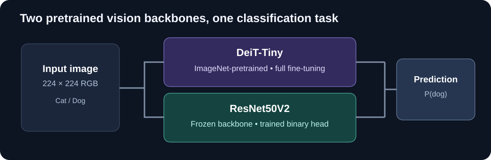
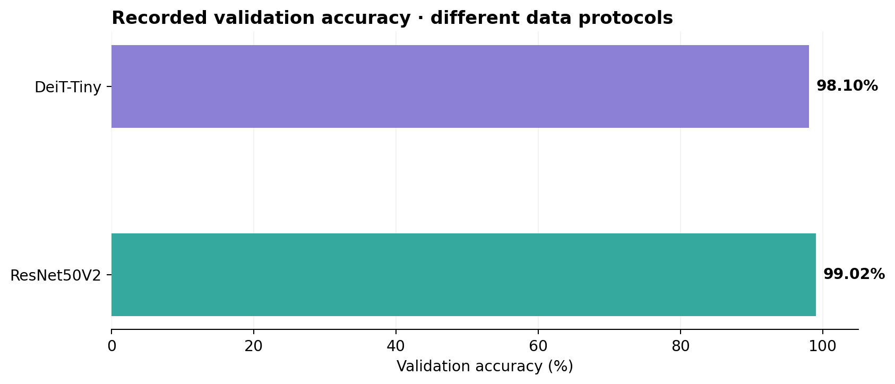
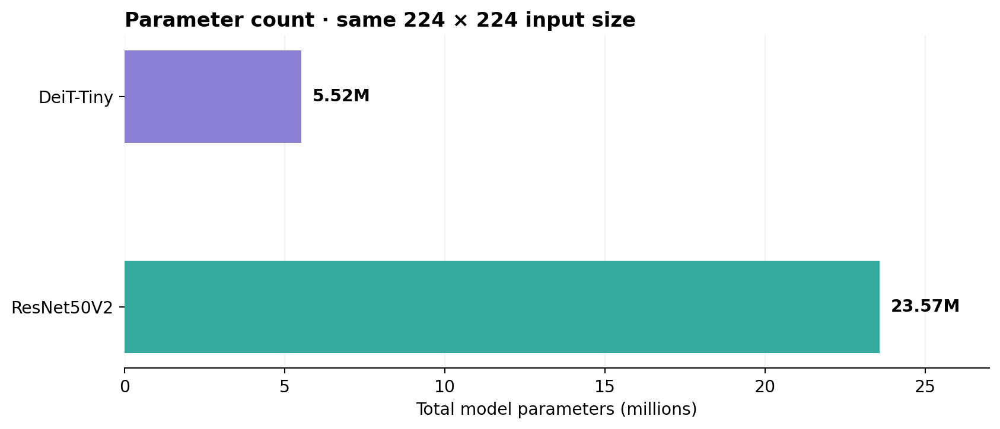
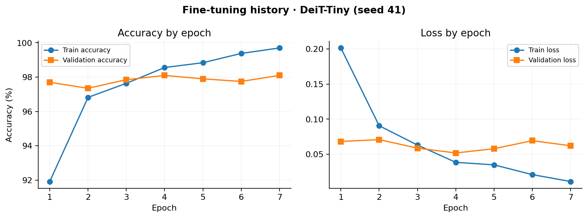
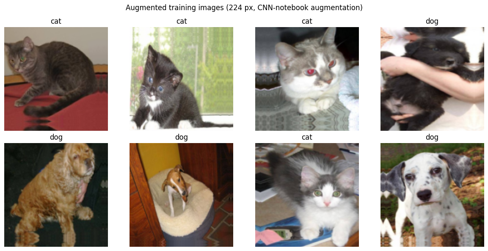
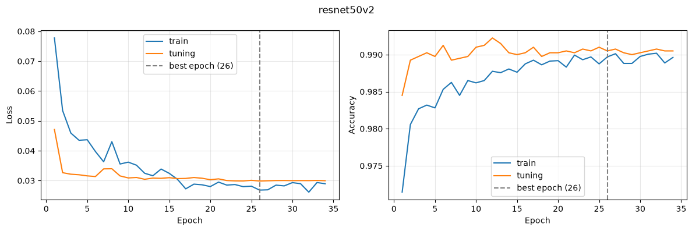
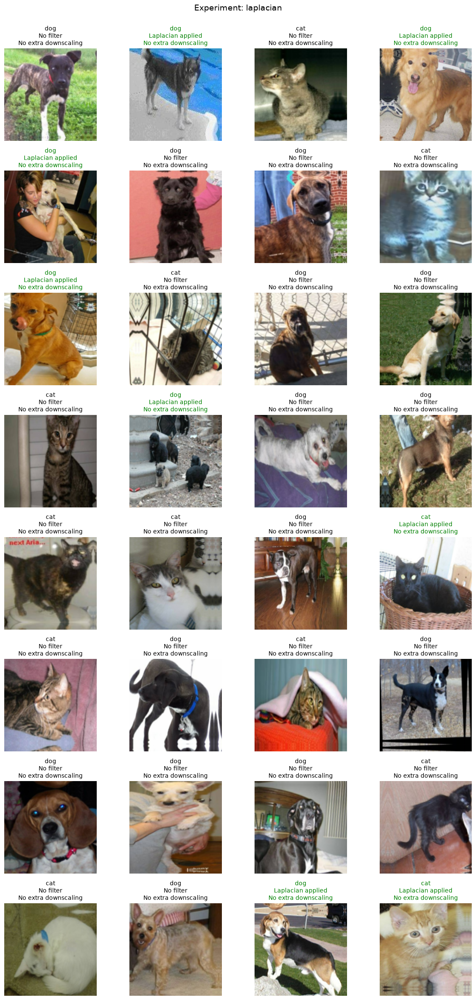

<div align="center">

# 🐾 Dogs vs. Cats | DeiT-Tiny vs ResNet50V2

### Exploring Vision Transformers and Residual CNNs through transfer learning, accuracy, and model efficiency

   

**DeiT-Tiny: 98.10% validation accuracy · 5.52M parameters**  
**ResNet50V2: 99.02% validation accuracy · 23.57M parameters**

</div>

> [!IMPORTANT]
> **Exploratory comparison, not a controlled benchmark.** The notebooks use different training/validation sample counts, augmentation policies, fine-tuning strategies, frameworks, and hardware. The accuracy gap **cannot** be attributed to architecture alone. See [Comparison caveats](#-comparison-caveats).



## 📊 Results at a glance

| Metric | DeiT-Tiny (ViT) | ResNet50V2 (CNN) |
|:--|--:|--:|
| **Recorded validation accuracy** | **98.10%** | **99.02%** |
| Validation ROC AUC | **0.9985** | Not separately reported for held-out validation |
| Model parameters | **5,524,609** | **23,566,849** |
| Trainable parameters | All parameters fine-tuned | 2,049 (classifier only) |
| Approx. FP32 parameter storage* | **22.1 MB** | **94.3 MB** |
| Input resolution | 224 × 224 RGB | 224 × 224 RGB |
| Images used for training | 5,000 | 16,000 |
| Validation images | 2,000 | 5,000 |
| Separate tuning split | No | 4,000 |
| Best checkpoint | Epoch 4 | Epoch 26 |
| Recorded training duration | 4.28 min | 103.52 min |
| GPU environment | Tesla T4 | RTX 3090 environment (multiple GPUs visible) |
| Inference latency | **6.41 ms/image GPU**, **43.32 ms/image CPU** | **Not measured comparably** |

*Calculated as total parameter count × 4 bytes per FP32 parameter, using decimal MB. The ResNet notebook's Keras summary shows ~89.90 MiB; this is consistent with ~94.3 MB in decimal units. These are **weight-size estimates**, not checkpoint-file size or peak runtime memory.*

**Main finding:** DeiT-Tiny achieves a recorded validation accuracy within **0.92 percentage points** of ResNet50V2 while using approximately **4.27× fewer total parameters**. This is a useful preliminary architecture-size comparison, **not** proof of equal accuracy under matched evaluation conditions or superior edge-device latency.

## 📈 Visual comparison

### Accuracy, with protocol caveats



### Model parameter cost



> The parameter chart is directly comparable as an architectural count. The accuracy chart is **descriptive only**, because the two experiments use different evaluation subsets and training setups. Training durations and GPU timings must also **not** be directly compared as speed measurements across models.

## 🧠 Models and experiments

### 🔮 DeiT-Tiny — Vision Transformer

- **Framework:** PyTorch + `timm`.
- **Architecture:** ImageNet-pretrained `deit_tiny_patch16_224`, replacing its ImageNet head with a single binary logit.
- **Training:** all layers fine-tuned with AdamW, linear warmup + cosine learning-rate scheduling, mixed precision on GPU.
- **Data:** 2,500 cats and 2,500 dogs for training; 1,000 per class for validation; seed 41.
- **Augmentation:** horizontal flipping, rotation, zoom and translation. ImageNet normalization.
- **Result:** 98.10% validation accuracy and 0.9985 AUC at the best checkpoint (epoch 4).
- **Efficiency profiling:** 2.149 estimated GFLOPs/image; recorded **6.41 ms GPU** and **43.32 ms CPU** inference on the run's benchmark environment.



<details>
<summary><b>DeiT input augmentation preview</b></summary>



</details>

### 🧩 ResNet50V2 — Residual Convolutional Network

- **Framework:** TensorFlow / Keras.
- **Architecture:** ImageNet-pretrained ResNet50V2 (`include_top=False`) with a **frozen** feature extractor, global average pooling, dropout (0.2), and a single sigmoid output.
- **Training:** classifier head only (2,049 trainable parameters), AdamW, mixed precision, learning-rate reduction and early stopping.
- **Data:** 8,000 per class for training, 2,000 per class for tuning, 2,500 per class for held-out validation; seed 41.
- **Augmentation:** geometric transformations and a selected **Laplacian** augmentation experiment; ResNet50V2-specific preprocessing.
- **Result:** **99.05% tuning accuracy** and **99.02% held-out validation accuracy**, with best checkpoint restored from epoch 26.
- **Efficiency:** 23.57M total parameters. The notebook does **not** record matched per-image inference latency or FLOPs for ResNet50V2.



<details>
<summary><b>ResNet image augmentation preview</b></summary>



</details>

## 🔬 Comparison caveats

| Dimension | Why it matters |
|:--|:--|
| **Different training data volumes** | ResNet used 16,000 training images vs 5,000 for DeiT. |
| **Different validation subsets** | Even with the same source dataset and seed value, the evaluation sets are not shown to contain the same examples. |
| **Different training strategy** | DeiT fine-tuned all layers; ResNet froze the pretrained backbone and trained only the classifier head. |
| **Different augmentation** | ResNet's recorded experiment selected Laplacian filtering; DeiT used geometric augmentation. |
| **Different environments** | DeiT ran on a Tesla T4 / PyTorch; ResNet on an RTX 3090 environment / TensorFlow. Training time is not a controlled throughput result. |
| **No paired latency data** | DeiT measured CPU and GPU latency, but there is no matched ResNet latency measurement. |

**For a rigorous follow-up:** evaluate both saved checkpoints on the exact same test files and preprocessing conventions; then benchmark both on identical hardware with the same batch size, warmup, and timing methodology. Report accuracy confidence intervals, latency distribution, and peak memory before drawing deployment conclusions.

## 🛠️ Reproduce the experiments

| Notebook | Environment | Starting point |
|:--|:--|:--|
| [`IE4483_ViT.ipynb`](IE4483_ViT.ipynb) | PyTorch, timm, torchvision, Google Colab | Configure `PROJECT_DIR` and place `IE4483.zip` in Google Drive. Run notebook sections in order. |
| [`IE4483_Resnet50V2.ipynb`](IE4483_Resnet50V2.ipynb) | TensorFlow / Keras, GPU environment | Update `PROJECT_DIR` and `DATA_DIR` to your dataset directory. Run notebook sections in order. |

Both expect separate `train/cat`, `train/dog`, `val/cat`, `val/dog`, and `test` image folders after extraction. The notebooks have **different path assumptions**, so adjust them individually before running. Dataset images and trained checkpoints are not bundled in this README package.

## 📁 Repository layout

```text
.
├── README.md
├── IE4483_ViT.ipynb
├── IE4483_Resnet50V2.ipynb
└── assets/
    ├── comparison-pipeline.svg
    ├── validation-accuracy.png
    ├── model-parameters.png
    ├── deit-training-history.png
    ├── deit-augmentation-preview.png
    ├── resnet-training-history.png
    └── resnet-augmentation-preview.png
```

## 💡 Engineering takeaways

1. **Accuracy must be interpreted in context.** A 0.92 percentage-point difference across different validation subsets cannot establish which architecture is better.
2. **Model size and model speed are different questions.** DeiT-Tiny's roughly 4.27× lower parameter count does not automatically mean lower FLOPs, faster inference, or lower energy consumption.
3. **Training policy matters.** Full transformer fine-tuning and a frozen convolutional backbone represent fundamentally different adaptation approaches.
4. **Deployment decisions need hardware-specific evidence.** No edge-device deployment or INT8 benchmark is claimed in these notebooks; future evaluation should use a common runtime and target device.

---

<div align="center"><sub>Exploring the trade-offs among predictive performance, model complexity, and deployability in modern vision architectures.</sub></div>
